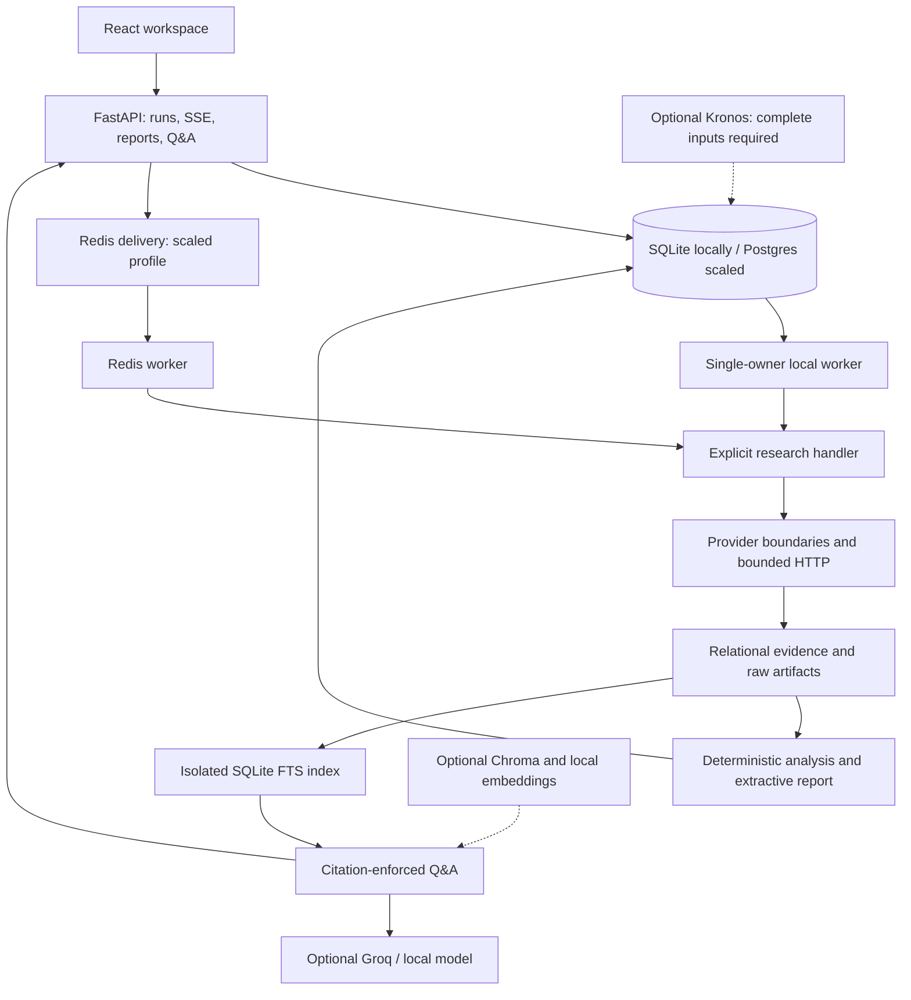

# Financial AI Agent

An evidence-first financial research workspace built with FastAPI, React and
durable research jobs. For research and education—not personalized investment
advice, a brokerage connection, or trade execution.

**Status: development preview, not a completed live-research product.** The
replacement workflow is tested offline but has not reached full legacy parity.
Flask and the old agents remain pending the [retirement gates](docs/replacement-workflow.md).
API health, synthetic demo output and passing fixture tests do not validate live
financial accuracy or investment performance.

## Start here

| Mode | What you get | Requirements |
| --- | --- | --- |
| Local Compose demo | Synthetic research with web, API, worker, Postgres and Redis | Docker with Compose v2; no provider keys |
| Local development | API, React UI and SQLite; jobs need a separate worker | Python 3.12/3.13, uv, Node 22/npm |
| Initial live collector | Yahoo identity/quote/adjusted closes, SEC metadata/facts and one configured RSS feed | Explicit opt-in, real SEC contact, approved feed; live validation outstanding |

### Synthetic demo

From a cloned checkout:

```bash
docker compose up --build --detach --wait --wait-timeout 180
docker compose exec -T api python -m financial_ai.ops smoke
```

Open <http://localhost:8080>. Demo values are synthetic, not current market data.
Startup downloads/builds software; “offline demo” means research uses no live
providers. `docker compose down` retains named volumes; do not add `--volumes`
unless intentionally deleting local data.
See [Compose verification](docs/local-compose.md). A release must record a
clean-machine smoke result; this README does not assert one was run.

### Local development

Install uv and Node/npm first if your shell reports `command not found`; see the
[prerequisites guide](docs/deployment.md#1-local-only-setup).
Use Python 3.12.13 by default (`.python-version`) or supported Python 3.13, and
Node 22.14.0 (`.nvmrc`) with npm 10. With nvm, run `nvm install` and `nvm use`
from the root. See [runtime selection and verification](docs/development-runtimes.md).
From the repository root:

```bash
uv --version
node --version
npm --version
uv sync --locked --all-groups
npm --prefix frontend/web ci
```

Run these in separate terminals:

```bash
# Terminal 1: API; SQLite migrations run at startup
uv run uvicorn financial_ai.api.app:create_app --factory --host 127.0.0.1 --port 8000
# Terminal 2: UI; /api requests proxy to the API
npm --prefix frontend/web run dev -- --host 127.0.0.1
```

Open <http://localhost:5173>; API documentation is at <http://localhost:8000/docs>.
`curl --fail http://127.0.0.1:8000/ready` checks readiness. A 404 at API `/` is
expected: the UI is served separately. No provider keys are needed for startup
or offline tests. Without a worker, submitted jobs remain pending.

For the opt-in live path, follow [replacement workflow setup](docs/replacement-workflow.md),
then start a third terminal:

```bash
uv run python -m financial_ai.workflow.local_worker
```

Use one local worker owner. Configure `ENABLE_LIVE_RESEARCH`, `SEC_USER_AGENT`,
approved `RESEARCH_NEWS_FEEDS`/`DOCUMENT_ALLOWED_HOSTS`, and the documented
`WORKER_HANDLER_FACTORY`. Preserve any existing `.env`; never commit it.
Adding FMP or Groq keys alone does not enable collection. The default Compose
factory remains synthetic regardless of keys in your host `.env`.

## Feature status and evidence

“Implemented” means source and offline tests exist, not that every adapter is
connected to the initial live collector. Missing inputs must remain visible.

| Capability | Implemented path / verification | Limits |
| --- | --- | --- |
| Durable research, progress, cancellation, retry | [Pipeline tests](tests/test_replacement_pipeline.py), [API tests](tests/test_api.py) | Explicit worker required; incomplete coverage can leave a failed run with a usable partial report |
| Source-linked reports and historical chart | [Pipeline](src/financial_ai/workflow/pipeline.py), [chart test](frontend/web/src/PriceHistory.test.tsx) | Extractive summaries and adjusted closes, not full OHLCV or broad analyst synthesis |
| Financial and technical calculations | [Financial goldens](tests/test_financial_analysis.py), [ETF/technical tests](tests/test_etf_quality_technical.py) | Modules exceed collector coverage; initial SEC mapping is annual USD and leaves missing metrics unavailable |
| Cited follow-up Q&A | [Q&A tests](tests/test_qa.py), [retrieval setup](docs/retrieval.md) | Generation requires configured Groq/local model; insufficient evidence is not invented; Chroma/local embeddings require optional wiring |
| History, watchlists, calendar, comparisons, portfolio context | [History](docs/history.md), [watchlists](docs/watchlists.md), [calendar](docs/calendar.md), [delta](docs/delta.md), [portfolio](docs/portfolio-context.md) | Saved-data views; opening them does not collect new data or fill missing exposures/events |
| Markdown, JSON and PDF exports | [Export contract](docs/exports.md), [tests](tests/test_exports.py) | Persisted content and available captured artifacts only; export availability is not redistribution permission |
| Provider/model diagnostics, quotas and audit | [Settings](docs/settings-console.md), [quotas](docs/quotas.md), [observability](docs/observability.md) | Local budgets, not verified account balances or uptime guarantees |
| Kronos forecasts and evaluation | [Kronos setup](docs/kronos.md), [benchmarks](docs/kronos-benchmarks.md) | Optional and experimental; real weights, complete calendar/action inputs and out-of-sample validation are separate gates |

**Integration roadmap:** full filing bodies, broader entity-relevant news,
ETF holdings/fees, valuation/analyst coverage, richer evidence-verified synthesis,
and forecast inputs still need end-to-end coverage in the replacement factory.
Its ETF path skips corporate statements; that is not complete ETF research.
See [remaining gates](docs/replacement-workflow.md#remaining-retirement-gates).

## Screenshots

Generate desktop/mobile captures with `make release-eval` after browser setup
below. The [screenshot review guide](docs/screenshots.md) identifies the files,
synthetic-data labels and manual review requirements. Generated screenshots
remain ignored local release artifacts; this README does not use mockups or
legacy UI images as evidence of replacement functionality.

## Architecture



Solid paths describe the replacement assembly; dashed paths require additional
configuration/input integration. Models are not sources of facts. Relational
evidence remains the system of record. See [architecture and boundaries](docs/architecture/README.md)
for responsibilities, ADRs, and current versus target architecture.

## Data, free-tier behavior and models

- No mandatory paid provider or hosted LLM for the demo or deterministic initial
  collector. Hardware, storage and network still have costs.
- SEC requires a real application/contact User-Agent. Yahoo access is best-effort
  and unofficial; RSS hosts must be explicitly allowlisted. The initial collector
  uses a direct Yahoo adapter, not an implicit OpenBB fallback.
- FMP, Groq and OpenBB are optional. Check quotas, permissions and available
  endpoints for the account and release date. No unlimited-free service,
  automatic paid fallback or proprietary analyst reports are promised.
- Timeouts, bounded retries, caches and local budgets limit requests. Exhaustion
  produces quota errors/coverage gaps; retries do not reset per-run budgets.
- Cite original documents, exact URLs, observation dates and units. Search
  results are discovery, not evidence. Preserve missing/stale/conflicting-data limitations.
- A free API or open-source adapter does not grant data redistribution rights.
  Review display, export, indexing and retention permissions separately.

The [source and licensing policy](docs/data/provider-policy.md) records decisions
and reference links. Its quota examples are review snapshots, not guaranteed
current limits. Project license: [AGPL-3.0-or-later](LICENSE); OpenBB distribution
or network use requires the documented compatibility and source-offer review.

Kronos is **disabled by default and experimental**. Base installation excludes
its optional runtime extra and weights. Installing the extra or enabling a flag
does not download models or create valid forecasting inputs. The initial live
collector lacks the complete OHLCV/calendar/corporate-action contract.
Sample bands are not calibrated confidence intervals or guaranteed targets.
Fixture CPU benchmarks do not establish real-weight accuracy, GPU performance,
or promotion. See [setup](docs/kronos.md), [workflow](docs/kronos-workflow.md)
and [promotion gates](docs/kronos-quality.md).

## Security and operational limits

This is a local, **unauthenticated** application. Bind to loopback; do not expose
API, demo credentials, dev/test servers or Ollama to untrusted networks. Public
deployment needs a separately reviewed authenticated gateway, HTTPS and deployment
controls. CSP/CSRF/host protections are not authentication.

Keep keys server-side and out of Git, logs, screenshots, exports and model context.
Treat documents as untrusted; allowlist download hosts rather than weakening
SSRF controls. Prompt-injection filtering is heuristic, not a guarantee.
Review dependency advisories before release: the [security guide](docs/security.md)
records unresolved dependency work.

See [operations](docs/deployment.md) for backups, restore, migrations, caches,
scaled self-hosting and troubleshooting. [Legacy migration](docs/legacy-migration.md)
archives/quarantines old records; uncited legacy reports are not verified evidence.

## Validation and release

```bash
make check
# Install Chromium once after npm ci (download requires network):
npm --prefix frontend/web exec -- playwright install chromium
make release-eval
```

`make check` runs lint, format, typing, Python/frontend tests and the production
build. `make release-eval` additionally produces quality reports, performance
results and browser captures under `data/runtime/release/<timestamp-id>/`.
Fixtures require no API keys or live financial requests. Dependency/browser
installation requires downloads. Scaled services, real Kronos weights, live
provider/LLM quality and manual accessibility review are separate validations.

Use the [release checklist](docs/release-checklist.md) for sign-off, exclusions,
source/security reviews and rollback evidence. Passing automation alone is not
release approval. Contributor rules: [AGENTS.md](AGENTS.md).
